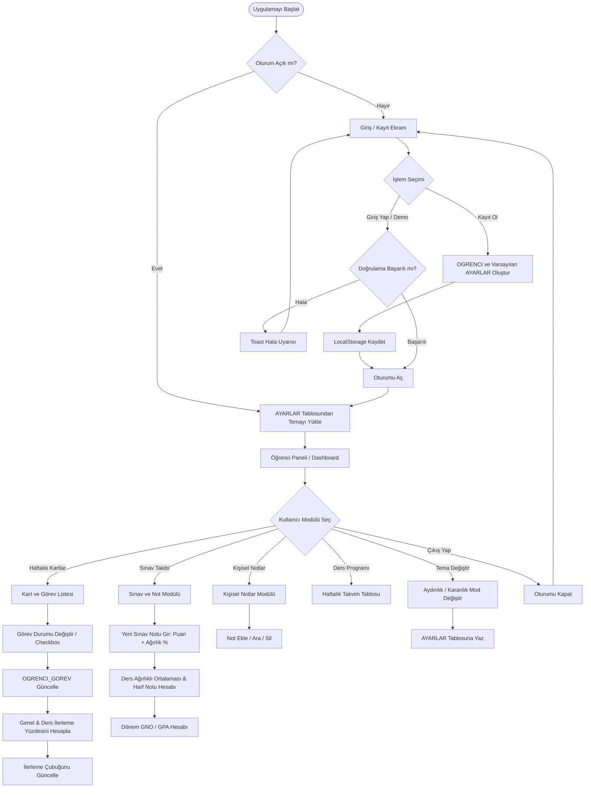

# 🎓 EduTrack - Etkileşimli Ders Deneyimi ve Takip Panosu

**EduTrack**, üniversite öğrencilerinin tüm akademik dönemini, haftalık öğrenme süreçlerini, sınavlarını, görevlerini ve kişisel notlarını tek bir merkezi panodan yönetebilmeleri amacıyla geliştirilmiş modern, etkileşimli ve tam kapsamlı bir web uygulamasıdır.

Bu proje, **Varlık-İlişki (ER) Veritabanı Diyagramı** ve **Sistem Akış Şeması (Flowchart)** mimarisine %100 sadık kalınarak geliştirilmiştir.

---

## 🏛️ 1. ER Veritabanı Mimarisi ve Tablo İlişkileri

Uygulama, tarayıcı üzerinde kalıcı (`localStorage`) çalışan ilişkisel bir veri tabanı simülasyon katmanı (`DatabaseService`) üzerine inşa edilmiştir:

| Tablo Adı | Birincil Anahtar (PK) | Yabancı Anahtarlar (FK) | Nitelikler ve Açıklamalar |
| :--- | :--- | :--- | :--- |
| **`OGRENCI`** | `ogrenci_id` | - | `ad`, `soyad`, `email`, `sifre_hash` (Kullanıcı kimlik doğrulama) |
| **`AYARLAR`** | `ayar_id` | `ogrenci_id` | `tema` (`light` / `dark` aydınlık ve karanlık mod tercihi) |
| **`DERSLER`** | `ders_id` | - | `ders_kodu`, `ders_adi`, `kredi` (AKTS değeri) |
| **`DERS_PROGRAMI`** | `program_id` | `ders_id` | `gun`, `baslangic_saati`, `bitis_saati`, `derslik` |
| **`HAFTALIK_KARTLAR`** | `kart_id` | `ders_id` | `hafta_no`, `baslik`, `icerik` (Haftalık konu özetleri) |
| **`GOREVLER`** | `gorev_id` | `kart_id`, `ders_id` | `baslik`, `tur` (`Okuma`, `Ödev`, `Quiz`, `Proje`, `Laboratuvar`) |
| **`OGRENCI_GOREV`** | Çift Anahtar | `ogrenci_id`, `gorev_id` | `durum` (`tamamlandi` / `devam_ediyor`) |
| **`SINAV_NOTLARI`** | `not_id` | `ogrenci_id`, `ders_id` | `sinav_turu` (Vize, Final, Quiz), `puan`, `agirlik_yuzdesi` |
| **`KISISEL_NOTLAR`** | `not_id` | `ogrenci_id` | `baslik`, `icerik`, `kategori`, `tarih` |
| **`ILERLEME`** *(Hesaplanan)* | - | `ogrenci_id`, `ders_id` | `tamamlanma_yuzdesi` = $( \text{Biten Görevler} / \text{Toplam Görevler} ) \times 100$ |

---

## 🔄 2. Kullanıcı Akış Şeması (Flowchart)

---

## ✨ 3. Başlıca Özellikler ve Modüller

1. **Öğrenci Paneli (Dashboard):**
   - Karşılama mesajı ve genel başarı ortalaması (GNO).
   - Canlı ve animasyonlu genel görev tamamlanma çubuğu (`% İlerleme`).
   - Ders bazında ilerleme göstergeleri.
   - Bugünün ders saatleri ve derslik bilgileri.
   - Öncelikli görevleri tek tıkla tamamlama listesi.

2. **Haftalık Ders ve Öğrenme Kartları:**
   - Ders seçimine göre filtreleme.
   - Hafta numarasına (Hafta 1 - 14) göre filtreleme.
   - Görev durumuna göre filtreleme (Yalnızca Tamamlananlar / Devam Edenler).
   - Kart içindeki görev checkbox'ları tıklandığında anında veri tabanına işleme ve progress barları güncelleme.
   - Modal ile yeni kart ve görev ekleme olanağı.

3. **Sınav Takibi ve Ortalama Hesaplama:**
   - Vize, Final, Quiz, Proje sınav puanları ve ağırlık yüzdeleri (`%`).
   - $\sum (\text{Puan} \times \text{Ağırlık}) / 100$ formülü ile ağırlıklı ortalama.
   - Üniversite harf notu skalası (AA, BA, BB, CB, CC, DC, DD, FF) ve Başarılı/Kaldı durumu.
   - Ders kredileri baz alınarak hesaplanan 4.00 üzerinden **Genel Not Ortalaması (GNO / GPA)**.

4. **Kişisel Notlar ve Hatırlatıcılar:**
   - Kategori etiketli notlar (Genel, Sınav Hazırlığı, Ödev/Proje, Önemli Hatırlatıcı).
   - Anlık metin içi arama çubuğu (Search Filter).
   - Yeni not ekleme ve silme.

5. **Haftalık Ders Programı (Takvim):**
   - Pazartesi-Cuma arası ders saatleri, derslik ve ders kodları çizelgesi.
   - Yeni ders ve program ekleme modalı.

6. **Tema ve Ayarlar (Aydınlık / Karanlık Mod):**
   - `AYARLAR` tablosunda saklanan kullanıcı tercihi.
   - CSS değişkenleri ile modern, göz yormayan karanlık mod paleti.

---

## 🚀 4. Kurulum ve Çalıştırma

Uygulama tamamen saf (Vanilla) HTML5, CSS3 ve modern ES6+ JavaScript ile geliştirilmiştir. Ekstra paket kurulumu (`npm install`, Node.js sunucusu vb.) gerektirmez.

### Hızlı Başlatma:
1. Klasördeki `index.html` dosyasına çift tıklayarak herhangi bir modern tarayıcıda (Chrome, Edge, Firefox, Safari) doğrudan açabilirsiniz.
2. Veya VS Code kullanıyorsanız `Live Server` eklentisiyle çalıştırabilirsiniz.

### Demo Hesap:
Giriş ekranında bulunan **"Demo Öğrenci ile Hemen Keşfet"** butonuna basarak, önceden yüklenmiş zengin ders, kart, görev, sınav ve not verileriyle sistemi hemen test edebilirsiniz.
