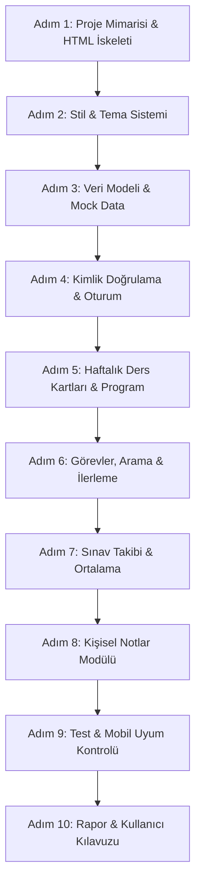

# Etkileşimli Ders Deneyimi Panosu — Yapay Zekâ Geliştirme Yol Haritası

Bu yol haritası, **Yazılım Geliştirme Dersi - Proje 1 (Etkileşimli Ders Deneyimi Panosu)** gereksinimlerine, veritabanı (ER) modeline ve kullanıcı akış şemasına uygun olarak hazırlanmıştır. Adımları sırayla yapay zekâya ileterek projeyi eksiksiz ve modüler biçimde tamamlayabilirsiniz.

---

## 📌 Genel Proje Bilgileri ve Kısıtlar
- **Teknoloji:** HTML5, CSS3, JavaScript (ES6+), Bootstrap 5 / Modern CSS, Tarayıcı `localStorage`.
- **Backend / Veritabanı:** Gerekli değildir; tüm veriler istemci tarafında `localStorage` ile saklanır.
- **Tasarım:** Modern, dinamik, temiz kart yapısı, aydınlık/karanlık tema, tam mobil uyumluluk (responsive).

---

## 🗺️ ADIM ADIM GELİŞTİRME PLANI

---

### ADIM 1: Proje Dosya Yapısı ve HTML İskeleti
* **Hedef:** Projenin dosya yapısını kurmak ve tüm bileşenleri (Navbar, Giriş Modalı, Sidebar/Sekmeler, Dashboard Alanları) içeren responsive `index.html` dosyasını oluşturmak.
* **Yapay Zekâya Verilecek Prompt:**
> "Etkileşimli Ders Deneyimi Panosu için `src/` klasöründe modern bir `index.html` dosyası oluştur. Bootstrap 5 ve Bootstrap Icons veya FontAwesome CDN bağlantılarını ekle. Sayfada şık bir üst navigasyon çubuğu (Logo, Aktif Kullanıcı, Karanlık/Aydınlık Tema Butonu, Çıkış Butonu), sol tarafta veya üstte sekmeler (Haftalık Dersler, Görevlerim, Sınav Takibi, Kişisel Notlar, Ders Programı) ve ana içerik alanı yer alsın. Ayrıca giriş yapma ve kayıt olma için şık bir modal veya karşılama ekranı ekle."

---

### ADIM 2: Modern Tasarım, CSS ve Tema Sistemi (Dark/Light Mode)
* **Hedef:** Kullanıcıyı etkileyen modern bir arayüz, kart tasarımları, yumuşak geçişler ve karanlık/aydınlık tema desteğini kurmak.
* **Yapay Zekâya Verilecek Prompt:**
> "Proje için `src/style.css` dosyasını hazırla. Hem modern açık tema (light) hem de göz yormayan şık koyu tema (dark mode) için CSS değişkenleri (variables) tanımla. Kartlar, butonlar, rozetler (badge), ilerleme çubukları ve formlar için modern gölgeler, yuvarlatılmış köşeler ve mikro animasyonlar ekle. Tema tercihini `localStorage`'a kaydedip sayfa yenilendiğinde hatırlayan JavaScript fonksiyonunu yaz."

---

### ADIM 3: Veri Modeli ve Başlangıç Verileri (`localStorage` & Mock Data)
* **Hedef:** ER şemasına (`DERSLER`, `HAFTALIK_KARTLAR`, `GOREVLER`, vb.) uygun JavaScript nesne yapısını kurmak ve ilk açılışta zengin örnek veriler yüklemek.
* **Yapay Zekâya Verilecek Prompt:**
> "`src/data.js` (veya `app.js` içinde) dosyasında projenin veri modelini oluştur. Eğer `localStorage`'da veri yoksa varsayılan olarak şu verileri yüklesin:
> - Yazılım Geliştirme dersine ait 14 haftalık konu başlıkları, özetleri ve öğrenme hedefleri,
> - Bu haftalara bağlı 'Yapılacak' ve 'Tamamlandı' durumunda örnek mini görevler/etkinlikler,
> - Haftalık ders programı (gün, saat, derslik bilgileri),
> - Örnek sınav notları (Vize %40, Final %60 ağırlıklı)."

---

### ADIM 4: Kullanıcı Yönetimi (Kayıt, Giriş ve Profil)
* **Hedef:** Kullanıcı akış şemasındaki "Kayıt Ol -> Doğrula -> Giriş Yap -> Paneli Aç" akışını çalıştırmak.
* **Yapay Zekâya Verilecek Prompt:**
> "Kullanıcı akış şemasına uygun olarak `localStorage` tabanlı basit ve güvenli bir kayıt olma ve giriş yapma sistemi kodla. Kullanıcı adı, e-posta ve şifre ile kayıt olunsun, giriş yapıldığında kullanıcının adı üst barda karşılansın ve oturum bilgisi saklansın. Çıkış yap (Logout) butonu oturumu sonlandırsın."

---

### ADIM 5: Haftalık Ders ve Öğrenme Kartları Modülü
* **Hedef:** Haftalık ders içeriklerini filtreleme ve ders programını takip etme.
* **Yapay Zekâya Verilecek Prompt:**
> "Haftalık ders kartlarını listeleyen fonksiyonu yaz. 
> - Her kartta: Hafta numarası, ders konusu, öğrenme hedefleri, o haftanın görev sayısı ve detay butonu bulunsun.
> - Haftaya veya duruma göre filtreleme dropdown'ı olsun.
> - Sistemde tanımlı ders programını (gün, başlangıç/bitiş saati, derslik) gösteren şık bir takvim/çizelge bileşeni ekle."

---

### ADIM 6: Görev Takibi, Arama ve Genel İlerleme Göstergesi
* **Hedef:** Mini etkinlikleri listeleme, arama yapma, durumu değiştirme ve anlık ilerleme yüzdesi hesaplama.
* **Yapay Zekâya Verilecek Prompt:**
> "Görev ve mini etkinlikler modülünü kodla:
> 1. Görevleri kart veya liste şeklinde göster (Başlık, Hafta, Tür/Etiket, Durum: Tamamlandı / Devam Ediyor).
> 2. Kullanıcı görevin durumunu checkbox veya buton ile değiştirebilsin, bu değişiklik anında `localStorage`'a kaydedilsin.
> 3. Canlı arama kutusu (input) ekle; kullanıcı yazdıkça görevler anlık filtrelensin.
> 4. Duruma göre (Tümü / Devam Edenler / Tamamlananlar) filtreleme butonları ekle.
> 5. Sayfanın en üstünde toplam tamamlanma yüzdesini gösteren dinamik bir dairesel veya yatay ilerleme çubuğu (Progress Bar) olsun."

---

### ADIM 7: Sınav Takibi ve Ortalama Hesaplama Modülü
* **Hedef:** ER şemasındaki `SINAV_NOTLARI` ve `SINAV_ORTALAMASI` tablolarının işlevini eklemek.
* **Yapay Zekâya Verilecek Prompt:**
> "Sınav takibi modülünü oluştur:
> - Vize, Final, Proje ve Quiz notlarını ağırlık yüzdeleriyle birlikte listeleyen bir tablo oluştur.
> - Yeni sınav/not ekleme ve silme formu ekle.
> - Ağırlıklı genel not ortalamasını otomatik hesaplayıp gösteren (örneğin: Vize %40 + Final %60 = Ortalama) ve harf notunu/başarı durumunu belirten dinamik bir hesaplayıcı kutusu ekle."

---

### ADIM 8: Kişisel Notlar Modülü (CRUD)
* **Hedef:** Öğrencinin dersle ilgili kendi notlarını ekleyip yönetebilmesi.
* **Yapay Zekâya Verilecek Prompt:**
> "Öğrencinin derslerle ilgili kişisel notlarını tutabileceği bir modül ekle:
> - Not başlığı ve içerik girilip 'Not Ekle' butonuna basıldığında tarih damgasıyla birlikte kaydetsin.
> - Notları kartlar halinde listelesin, silme (Delete) ve düzenleme (Edit) seçenekleri sunsun.
> - Tüm notlar `localStorage` ile kalıcı olsun."

---

### ADIM 9: Test Senaryoları ve Mobil Uyum (Responsive) Kontrolü
* **Hedef:** Hata kontrolü, boş durum (empty state) mesajları, mobil cihaz uyumluluğu.
* **Yapay Zekâya Verilecek Prompt:**
> "Uygulamanın tüm kontrollerini yap:
> - Mobil, tablet ve masaüstü ekranlarda düzenin bozulmadığını kontrol et.
> - Hiç görev veya not olmadığında gösterilecek bilgilendirici boş durum (Empty State) mesajları ve ikonları ekle.
> - Kullanıcı işlemlerinde (görev tamamlandı, not eklendi vb.) modern toast/bildirim mesajları göster."

---

### ADIM 10: Dokümantasyon, Rapor ve Teslim Paketi
* **Hedef:** Rolünüz olan 'Dokümantasyon / Sunum' çıktısını eksiksiz hazırlamak.
* **Yapay Zekâya Verilecek Prompt:**
> "Proje 1 için teslim dokümantasyonunu hazırla:
> 1. `docs/` klasörüne akademik formatta detaylı bir Proje Raporu (Giriş, İhtiyaç Analizi, Sistem Mimarisi, Kullanıcı Senaryoları, Ekip Rol Dağılımı ve Katkılar, Sonuç).
> 2. Son kullanıcı için adım adım Kullanıcı Kılavuzu (Ekran görüntüleri açıklamalarıyla birlikte).
> 3. `presentation/` klasörüne slayt sunumu için hazır konuşma metni ve sunum taslağı.
> 4. `README.md` dosyasını son ekran görüntüleri, özellikler ve çalıştırma adımlarıyla güncelle."
