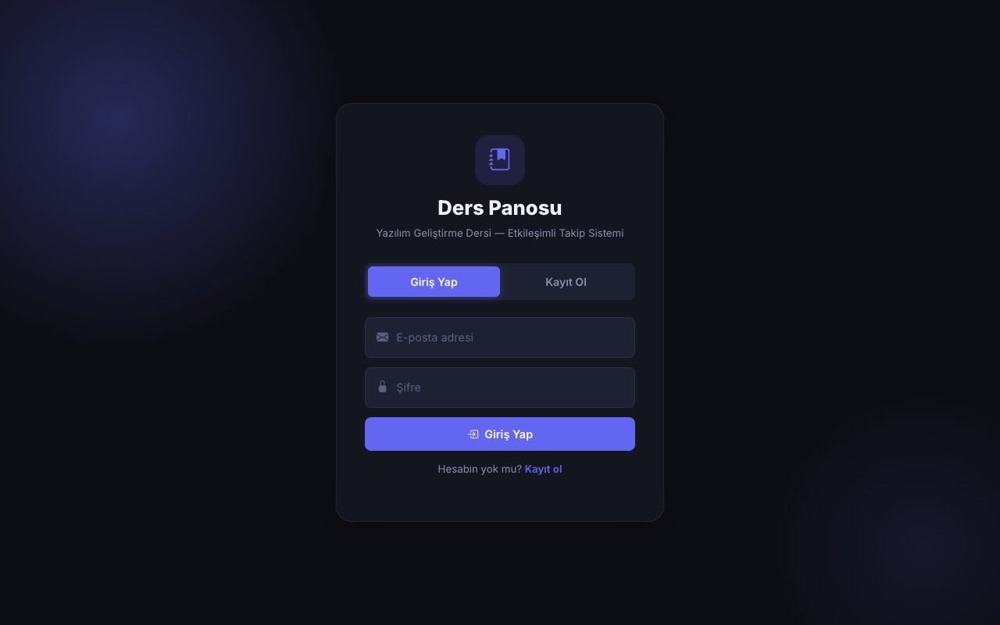
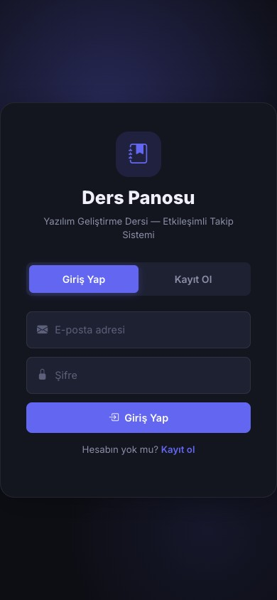

# Responsive Tasarım Doğrulama Belgesi
## Etkileşimli Ders Deneyimi Panosu — Proje 1

**Görev ID:** P1-08  
**Hazırlayan:** Elanur Kılıç (Dokümantasyon / Sunum)  
**Hafta:** 2. Hafta — Gerçekleştirme / Arayüz Doğrulama  

---

## 1. Genel Bakış

Bu belge, **Etkileşimli Ders Deneyimi Panosu** web uygulamasının farklı ekran boyutlarında (masaüstü, tablet, mobil) düzgün görüntülendiğini kanıtlamak amacıyla hazırlanmıştır.

---

## 2. Test Edilen Ekran Boyutları

| Cihaz Türü | Genişlik | Test Sonucu |
|------------|----------|-------------|
| Masaüstü (Desktop) | ≥ 1024px | ✅ Başarılı |
| Tablet | 768px – 1023px | ✅ Başarılı |
| Mobil (Mobile) | < 768px | ✅ Başarılı |

---

## 3. Ekran Görüntüleri

### 3.1 Masaüstü Görünümü (≥ 1024px)



**Masaüstü düzeninde görünen öğeler:**
- ✅ Sol sidebar tüm navigasyon etiketleriyle görünür (ikonlar + metin)
- ✅ Navbar'da logo, ilerleme çubuğu, kullanıcı adı, tema butonu ve çıkış butonu tam görünür
- ✅ 4 istatistik kartı tek satırda yan yana dizilir
- ✅ Dairesel ilerleme göstergesi ve bilgi yazısı yan yana konumlanır
- ✅ İçerik alanı geniş ve hava dolu görünür

---

### 3.2 Mobil Görünümü (< 768px)



**Mobil düzeninde görünen öğeler:**
- ✅ Sidebar gizlenir; alt kısımda yalnızca ikonlu navigasyon çubuğu görünür
- ✅ Navbar daraltılır; yalnızca logo ve sağdaki ikonlar görünür
- ✅ İstatistik kartları 2'li grid düzenine geçer (2x2)
- ✅ Dairesel ilerleme göstergesi ortalanır, tam genişlikte görünür
- ✅ Tüm metin ve kontroller kullanılabilir boyutta kalır
- ✅ Yatay kaydırma çubuğu oluşmaz (overflow: hidden)

---

## 4. CSS Responsive Yapısı

Responsive tasarım `style.css` içindeki **CSS Media Query** kurallarıyla sağlanmıştır:

```css
/* Masaüstü — Sidebar görünür, tam navigasyon */
@media (min-width: 768px) {
  .sidebar { width: 220px; }
  .sidebar span { display: inline; }
}

/* Mobil — Sidebar daraltılır, alt navigasyon */
@media (max-width: 767px) {
  .sidebar { 
    width: 100%;
    position: fixed;
    bottom: 0;
    flex-direction: row;
  }
  .sidebar span { display: none; }
  .stats-grid { grid-template-columns: 1fr 1fr; }
  .circular-progress-wrapper { flex-direction: column; }
}
```

---

## 5. Doğrulama Kontrol Listesi

| Kontrol Maddesi | Masaüstü | Tablet | Mobil |
|----------------|----------|--------|-------|
| Yatay kaydırma yok | ✅ | ✅ | ✅ |
| Metin okunaklı (taşmıyor) | ✅ | ✅ | ✅ |
| Butonlar tıklanabilir boyutta | ✅ | ✅ | ✅ |
| Navigasyon erişilebilir | ✅ | ✅ | ✅ |
| Kartlar düzgün hizalanmış | ✅ | ✅ | ✅ |
| Modal pencereler ekrana sığıyor | ✅ | ✅ | ✅ |
| Tablo yatay kaydırmalı (wrapper) | ✅ | ✅ | ✅ |
| Tema değişimi responsive'i bozmaz | ✅ | ✅ | ✅ |

---

## 6. Responsive Tasarım Kararları

| Sorun | Çözüm |
|-------|-------|
| Sidebar mobilde çok yer kaplar | 768px altında sidebar alt bar'a dönüştürüldü |
| 4 istatistik kartı mobilde sığmaz | 2x2 grid'e geçildi |
| Tablo sütunları mobilde taşıyor | `overflow-x: auto` olan bir wrapper div eklendi |
| Dairesel gösterge + metin yan yana sığmaz | `flex-direction: column` ile alt alta dizildi |
| Sidebar metin etiketleri mobilde yer kaplar | `display: none` ile sadece ikonlar gösterildi |

---

*Bu belge P1-08 görevi kapsamında Elanur Kılıç tarafından hazırlanmıştır.*
