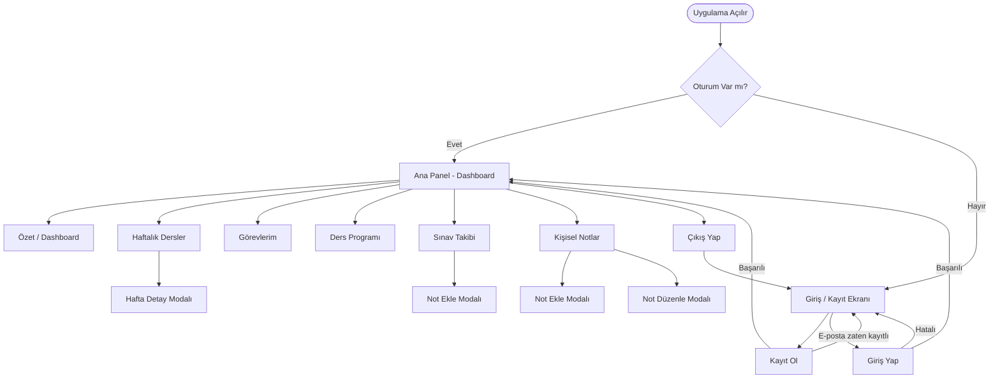

# Ekran / Sayfa Haritası ve Wireframe Belgesi
## Etkileşimli Ders Deneyimi Panosu — Proje 1

**Görev ID:** P1-04  
**Hazırlayan:** Elanur Kılıç (Dokümantasyon / Sunum)  
**Hafta:** 1. Hafta — Sistem ve Arayüz Tasarımı  

---

## 1. Sayfa Haritası (Sitemap)

```
Uygulama
├── 🔐 Kimlik Doğrulama Ekranı (Auth Screen)
│   ├── Giriş Yap (Login)
│   └── Kayıt Ol (Register)
│
└── 📊 Ana Uygulama (Main App)  [Giriş sonrası]
    ├── 🏠 Özet / Dashboard
    ├── 📅 Haftalık Dersler
    │   └── Hafta Detay Modalı
    ├── ✅ Görevlerim
    ├── 🕐 Ders Programı
    ├── 📈 Sınav Takibi
    │   └── Not Ekle Modalı
    └── 📝 Kişisel Notlar
        └── Not Ekle / Düzenle Modalı
```

---

## 2. Kullanıcı Akış Şeması



---

## 3. Ekran Wireframe'leri

### 3.1 Giriş / Kayıt Ekranı

```
┌──────────────────────────────────────┐
│                                      │
│         📖  Ders Panosu              │
│    Yazılım Geliştirme — Takip        │
│                                      │
│  ┌──────────┬──────────────────┐     │
│  │ Giriş Yap│    Kayıt Ol      │     │
│  └──────────┴──────────────────┘     │
│                                      │
│  📧 ________________________         │
│     E-posta adresi                   │
│                                      │
│  🔒 ________________________         │
│     Şifre                            │
│                                      │
│  ┌────────────────────────────┐      │
│  │        Giriş Yap           │      │
│  └────────────────────────────┘      │
│                                      │
│  Hesabın yok mu? Kayıt ol            │
└──────────────────────────────────────┘
```

---

### 3.2 Ana Panel (Dashboard) — Masaüstü

```
┌─────────────────────────────────────────────────────────────────┐
│ 📖 DersPano   ████████░░ 60% Tamamlandı    👤 Elanur  🌙  ↪    │
├───────────┬─────────────────────────────────────────────────────┤
│           │                                                       │
│  🏠 Özet  │   Genel Özet          Perşembe, 29 Ekim 2026         │
│  📅 Hafta │                                                       │
│  ✅ Görev │  ┌──────┐  ┌──────┐  ┌──────┐  ┌──────┐            │
│  🕐 Prog. │  │  14  │  │  8   │  │  6   │  │  78  │            │
│  📈 Sınav │  │ Hafta│  │Tamam │  │Devam │  │ Ort. │            │
│  📝 Not   │  └──────┘  └──────┘  └──────┘  └──────┘            │
│           │                                                       │
│           │        ╔════════╗                                     │
│           │        ║  60%   ║   Genel İlerlemeniz                 │
│           │        ║       ║   8/14 görev tamamlandı              │
│           │        ╚════════╝                                     │
│           │                                                       │
│           │  ⚡ Son Görevler                                       │
│           │  ● GitHub repo oluştur        [Tamamlandı]           │
│           │  ○ HTML iskelet               [Devam Ediyor]         │
└───────────┴─────────────────────────────────────────────────────┘
  Sidebar      İçerik Alanı
```

---

### 3.3 Haftalık Dersler Ekranı

```
┌───────────┬─────────────────────────────────────────────────────┐
│  Sidebar  │  Haftalık Ders İçerikleri    [Tüm Haftalar ▼]       │
│           │                                                       │
│           │  ┌─────────────┐ ┌─────────────┐ ┌─────────────┐   │
│           │  │  Hafta 1    │ │  Hafta 2    │ │  Hafta 3    │   │
│           │  │ Yazılım     │ │ Proje Plan. │ │ HTML/CSS    │   │
│           │  │ Sürecine    │ │             │ │             │   │
│           │  │ Giriş       │ │ 3 Görev     │ │ 2 Görev     │   │
│           │  │ 2 Görev     │ │ [Detay →]   │ │ [Detay →]   │   │
│           │  │ [Detay →]   │ └─────────────┘ └─────────────┘   │
│           │  └─────────────┘  ...14 kart toplam                 │
└───────────┴─────────────────────────────────────────────────────┘
```

---

### 3.4 Görevlerim Ekranı

```
┌───────────┬─────────────────────────────────────────────────────┐
│  Sidebar  │  Görevlerim                                          │
│           │  🔍 [Görev ara...                    ]              │
│           │                                                       │
│           │  [Tümü]  [Devam Edenler]  [Tamamlananlar]           │
│           │                                                       │
│           │  ┌─────────────────────────────────────────────┐    │
│           │  │ ☑  GitHub repository oluştur                │    │
│           │  │    Hafta 1 · Proje          [Tamamlandı ✓]  │    │
│           │  └─────────────────────────────────────────────┘    │
│           │  ┌─────────────────────────────────────────────┐    │
│           │  │ ☐  HTML iskelet oluştur                     │    │
│           │  │    Hafta 1 · Geliştirme     [Devam Ediyor]  │    │
│           │  └─────────────────────────────────────────────┘    │
└───────────┴─────────────────────────────────────────────────────┘
```

---

### 3.5 Sınav Takibi Ekranı

```
┌───────────┬─────────────────────────────────────────────────────┐
│  Sidebar  │  Sınav Takibi                        [+ Not Ekle]   │
│           │                                                       │
│           │  ┌─────────────────────────────────────────────┐    │
│           │  │  ⊙ 74.0      BB      Vize %40 · Final %60   │    │
│           │  │  Ağırlıklı Ortalama · Harf Notu             │    │
│           │  └─────────────────────────────────────────────┘    │
│           │                                                       │
│           │  ┌───────────┬──────┬──────┬──────────┬────────┐   │
│           │  │ Tür       │ Not  │ Ağır.│ Ağ.Puan  │ Tarih  │   │
│           │  ├───────────┼──────┼──────┼──────────┼────────┤   │
│           │  │ Vize      │  70  │ %40  │  28.0    │ ... 🗑️ │   │
│           │  │ Final     │  80  │ %60  │  48.0    │ ... 🗑️ │   │
│           │  └───────────┴──────┴──────┴──────────┴────────┘   │
└───────────┴─────────────────────────────────────────────────────┘
```

---

### 3.6 Kişisel Notlar Ekranı

```
┌───────────┬─────────────────────────────────────────────────────┐
│  Sidebar  │  Kişisel Notlar                      [+ Not Ekle]   │
│           │                                                       │
│           │  ┌─────────────────┐  ┌─────────────────┐           │
│           │  │ Git Komutları   │  │ CSS Değişkenleri │           │
│           │  │ 15 Ekim 2026    │  │ 18 Ekim 2026     │           │
│           │  │                 │  │                  │           │
│           │  │ git add .       │  │ :root { ... }    │           │
│           │  │ git commit...   │  │                  │           │
│           │  │        ✏️ 🗑️   │  │         ✏️ 🗑️   │           │
│           │  └─────────────────┘  └─────────────────┘           │
└───────────┴─────────────────────────────────────────────────────┘
```

---

### 3.7 Mobil Görünüm (< 768px)

```
┌──────────────────────┐
│ 📖 DersPano    🌙  ↪ │
├──────────────────────┤
│ ████████░░  60%      │
├──────────────────────┤
│                      │
│  ┌──────┐  ┌──────┐  │
│  │  14  │  │  8   │  │
│  │Hafta │  │Tamam │  │
│  └──────┘  └──────┘  │
│  ┌──────┐  ┌──────┐  │
│  │  6   │  │  78  │  │
│  │Devam │  │ Ort. │  │
│  └──────┘  └──────┘  │
│                      │
│      ╔═══════╗       │
│      ║  60%  ║       │
│      ╚═══════╝       │
│                      │
│ ──────────────────── │
│ 🏠  📅  ✅  📈  📝   │
└──────────────────────┘
```

---

## 4. Bileşen Envanteri

| Bileşen | Açıklama | Ekranlar |
|---------|----------|---------|
| **Navbar** | Logo, ilerleme çubuğu, kullanıcı adı, tema butonu, çıkış | Tüm sayfalar |
| **Sidebar** | Sekme navigasyonu (masaüstü) | Tüm sayfalar |
| **İstatistik Kartı** | Sayı + etiket | Dashboard |
| **Dairesel İlerleme** | SVG bazlı yüzde göstergesi | Dashboard |
| **Hafta Kartı** | Hafta no, başlık, özet, görev sayısı | Haftalık Dersler |
| **Görev Kartı** | Checkbox, başlık, etiket, durum rozeti | Görevlerim |
| **Sınav Tablosu** | Tür, not, ağırlık, ağırlıklı puan, tarih | Sınav Takibi |
| **Not Kartı** | Başlık, içerik, tarih, düzenle/sil butonları | Kişisel Notlar |
| **Modal** | Overlay + kart yapısı | Hafta detay, Not ekle, Sınav ekle |
| **Toast Bildirimi** | Geçici bilgi mesajı | Tüm sayfalar |

---

## 5. Renk ve Tema Sistemi

| Token | Dark Tema | Light Tema | Kullanım |
|-------|-----------|------------|---------|
| `--bg-primary` | `#0f1117` | `#f8fafc` | Sayfa arkaplanı |
| `--bg-card` | `#1a1d27` | `#ffffff` | Kart arkaplanı |
| `--accent` | `#6c63ff` | `#6c63ff` | Vurgu rengi, butonlar |
| `--text-primary` | `#e8eaf6` | `#1a1a2e` | Ana metin |
| `--success` | `#10b981` | `#059669` | Tamamlandı durumu |
| `--warning` | `#f59e0b` | `#d97706` | Devam ediyor durumu |

---

*Bu belge P1-04 görevi kapsamında Elanur Kılıç tarafından hazırlanmıştır.*
